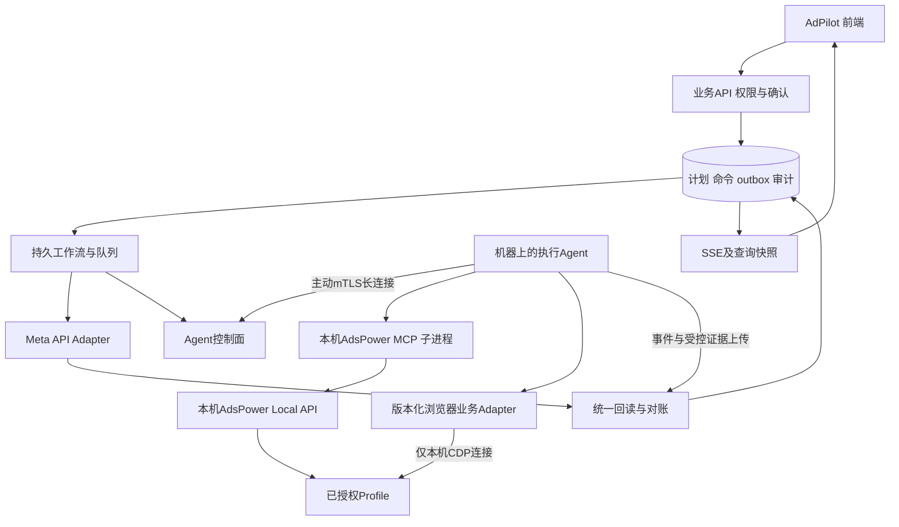

# 本版范围适用说明

本文为原合同详细语义基线。已删除的独立模块流程不再实施，适用边界以01_修订需求与删除边界.md为准；保留页面的字段、AI闭环、预算、状态与双通道规则不因此删除。

# AdsPower MCP 对接和广告执行工作流

版本1.2，2026-11-03。本文补齐AdsPower执行通道，不把“已接MCP”当成“已经实现广告业务”。属于待开发方案，未连接实际机器或操作广告。

## 1 官方能力和系统边界

AdsPower官方提供LocalAPI MCP Server，用于管理浏览器环境、启动及关闭Profile等操作。[官方说明](https://help.adspower.net/docs/bBLQhb)

Local API启动Profile可返回浏览器调试连接，供自动化程序连接。[启动接口](https://localapi-doc-en.adspower.com/docs/FFMFMf)

官方仓库当前提供local-api-mcp-typescript的MCP配置；PORT和API_KEY可从环境传入，部分API依赖客户端版本。[官方仓库](https://github.com/AdsPower/adspower-browser)

本系统复用官方MCP的环境能力，在外面增加执行Agent、权限及租约、版本化Meta页面适配器和持久工作流。必须区分：Profile打开、Facebook登录有效、广告账户身份匹配、动作已提交、配置已核验、广告实际投放。每项各有状态。

生产连接保持Local API安全校验，不采用旧教程关闭校验的做法；API Key留在执行机器，云端和前端不接触浏览器调试地址或Cookie。当前官方Local API文档说明安全校验开启时调用需Bearer API Key。[API概览](https://localapi-doc-en.adspower.com/docs/Rdw7Iu)

## 2 部署拓扑

执行Agent是常驻服务，不是用户浏览器标签页，也不是Codex开发会话。用户关闭AdPilot页面后任务继续。MCP通过本机stdio子进程运行，生产锁定包版本和依赖完整性，不每次下载latest。控制面不远程连接用户localhost。

MCP只在需要接入工具协议时使用；Agent可以用同一适配层直接调用Local API。两者应共享测试，不建立两套广告业务规则。若开发环境只把MCP装进Codex，只能帮助联调，不能承担100用户生产后台调度。

首期同时交付META_API与ADSPOWER_UI执行适配器的代码和合同；生产启用按operation_kind、对象层级、页面语言、AdsPower/内核版本、页面Adapter版本及测试回执逐项控制。未验证操作返回CAPABILITY_UNVERIFIED，不假装完成。API优先是默认路由策略，可由授权用户在预览前显式选择UI；不保证所有目标组合都支持UI。

## 3 Profile绑定与并发

绑定关系为tenant_id+agent_id+profile_external_id+account_id，并保存owner_user_id、owner_team_id、binding_revision。一个Profile可访问多个广告账户，但一次只能租给一个工作流；一个账户可有多个验证过的Profile，调度时固定其中一个，运行中不自动切换身份。

选Profile先取AdPilot数据范围与账号平台权限交集；团队管理员看本团队、超级管理员看全部，也不能借可见Profile操作未获平台授权的账户。每次不可逆提交前重新核对页面account_id、实体ID、币种、层级和当前预算/状态。不能只用账户名称或浏览器标题判断。

Profile租约默认120秒，每20秒续租；机器心跳15秒，45秒SUSPECT、90秒OFFLINE。UI每个外部写动作还获取账户+对象树/预算拥有者锁，和API通道共用，因此API与UI不能并行修改同目标。租约过期立即停止新动作，已点击提交但结果不明进入UNKNOWN；仅有本地fencing无法撤销已发网页请求，禁止立即让新Worker再次点击。

默认每机器同时最多2个活动Profile，配置可调并以实际性能验证；一个Profile只允许1个写流程。Local API按实际版本限流，启动默认1请求/秒并对429退避；不把MCP吞吐当作平台广告配额。

已有人工使用的Profile不强占；返回PROFILE_BUSY。清理时只关闭本工作流启动且独占的Profile，不能关闭别人已打开的窗口。验证码、二次验证或账户身份不符进入NEEDS_HUMAN，并释放写发送能力；用户完成后重新预检与授权，不自动绕过验证。

## 4 工作流拆分

使用同一持久引擎，拆出6条可单独版本化、恢复和测试的workflow；最后两条由前四条共用。

|workflow_id|责任|稳定输入|
|---|---|---|
|launch_ads_v1|建立系列/组/创意/广告，默认暂停；另排启用|冻结计划hash、展开节点、分配和命名reservation、执行通道|
|set_budget_v1|设置真实预算拥有者的绝对目标金额|target、budget_owner、before、after、currency、policy及预览hash|
|pause_entity_v1|暂停广告/广告组/系列|准确对象ID、层级、原状态、影响集合|
|delete_entity_v1|真正删除；不能用归档代替|准确对象ID、层级、子树快照、delete_ack、reason|
|verify_operation_v1|独立读取并比对平台最终配置，持续对账|operation_id、目标字段、平台回执、证据引用|
|recover_unknown_v1|失联/崩溃/未知结果后的保守恢复和人工处置|原operation/attempt、写前日志、外部ID、证据|

ENABLE/ARCHIVE为独立命令适配器，使用同一执行/核验模板；不是PAUSE或DELETE的别名。ENABLE只在用户原确认含启用授权且创建已核验后排队。没有开启广告的权限则仅创建PAUSED。

## 5 创建流程

1. 创建API原子保存task、DAG、命令和outbox；同plan_id+revision只产生一任务，重复键返回原任务。
2. 校验用户数据范围、菜单、动作权限、渠道和素材、目标能力、版本及计划TTL；绑定机器与Profile，获取租约。
3. 启动/连接Profile，核对登录、广告账户、主页/像素/应用等身份资源。失败停止，不创建任何广告。
4. 根据冻结展开树依次填系列→广告组→广告配置及素材；实际页面可能最后统一发布，Adapter必须定义“仅页面草稿”与“平台已提交”的边界，不能每点下一步就计已创建。
5. 最终发布前再次核对页面显示的名称、对象数、预算归属与金额、币种、暂停/启用状态、身份资源；差异则PAGE_STATE_MISMATCH。
6. 本地持久化WRITE_INTENT并提交云端已准备状态，然后执行一次发布动作；记录attempt_id和提交时间。Agent崩溃恢复必须先查日志与平台，不能直接重放click。
7. 收集可验证的external_id和响应/页面证据；能识别的节点立即持久化。平台部分成功则逐节点记录，独立分支可以继续。
8. 调用verify_operation_v1。只有广告ID及父级/创意/账户/目标配置核验完成才计创建数；仅看到成功toast不计数。
9. 若用户确认创建后启用，创建核验成功后另发ENABLE，启用也独立回读。任务区分“创建成功”和“启用失败”。

平台统一提交涉及多对象时使用submission_group_id。响应丢失则整个提交组中未能证明结果的节点UNKNOWN；不得把不确定节点重建。未发生平台提交的页面草稿可丢弃并按原冻结输入重建，但必须有可验证的未发送证据。

## 6 修改预算

获取预算拥有者锁→重新取预算和币种→核对预览before→检查20%单次/30%滚动累计和额度预占→定位系列或组预算→填写绝对after→复核页面值→写WRITE_INTENT→单次保存→提交独立核验。

不对广告对象写预算。两个广告属于同一预算系列时，同金额只生成一命令，不同金额阻止。原预算100、目标120，重试仍是设置120，不能再次“加20%”。如其他工具已把100改为110，返回STALE_PREVIEW，不覆盖。

## 7 关闭和删除

关闭：PAUSE准确对象，复核影响子树；已处于目标暂停状态且版本/范围仍合法，可核验后返回SUCCEEDED_NOOP，命令状态仍SUCCEEDED并标no_op=true。

删除：检查暂停时长/成熟度/保留策略、子树和人工确认；只点击明确表示删除的受支持流程。出现“归档”而无删除能力则UNSUPPORTED_DELETE，不改做归档。页面没有对象可能是筛选或权限问题，不能据此认定删除成功。须有原提交关联证据、权限仍有效及平台版本语义支持。

默认配置核验走Meta只读API；账户没有API只读权限时可采集独立刷新后的UI证据，但首期不自动升级为已核验成功，显示SUBMITTED_UNVERIFIED（用户展示状态，命令保存UNKNOWN+reason=READBACK_UNAVAILABLE），进入人工对账。已获授权的UI操作不等于具有Graph API权限。

## 8 反馈与证据

反馈包含三个层次：

- 环境：机器心跳、Local API、Profile进程、登录、身份、租约；页面可看到“浏览器已打开，但账号需登录”。
- 执行：排队、预检、填写、待提交、已提交、核验、重试、人工介入；每个节点都可追踪。
- 业务：配置是否匹配、是否实际投放、预算前后值、创建对象及ID、失败原因；配置已成功但审核中不显示“正在投放”。

每条事件包含event_id、sequence、operation_id、task_id、node_id、attempt_id、agent_id、profile_binding_id、workflow_version、adapter_version、phase、occurred_at、state、error_code、retryable、evidence_refs。证据保存写前配置、期望配置、受控脱敏截图、实际读回值、对象ID、平台错误和时间；Cookie/Token/CDP URL禁止进入事件和截图可见区域。截图失败不抹除写结果。

Agent本地SQLite/WAL持久spool保存intent和事件，收到云端ack后才标已交付；云端按event_id去重，按attempt及sequence拒绝旧状态回写。缺序列请求补传；磁盘不可写或云端失联时禁止新的不可逆提交，已发送继续本地留证并只读核验。Agent重启使用新boot_id，但恢复原operation/attempt，不创建新操作。

前端通过SSE及快照轮询读取服务端状态，不能以浏览器MCP返回success或前端定时器改为成功。SSE恢复规则沿用WORKFLOWS.md。

错误至少包含PROFILE_BUSY、LOCAL_API_UNAVAILABLE、LOGIN_REQUIRED、CHALLENGE、IDENTITY_MISMATCH、CAPABILITY_UNVERIFIED、PAGE_CHANGED、PAGE_STATE_MISMATCH、STALE_PREVIEW、LEASE_LOST、SUBMIT_RESULT_UNKNOWN、READBACK_UNAVAILABLE、VERIFICATION_MISMATCH。

## 9 MCP工具封装

以下是本系统拟实现的业务工具名，不宣称是AdsPower官方现有工具：

- adpilot.preview_launch / execute_launch
- adpilot.preview_optimization / execute_optimization
- adpilot.get_operation / get_task / cancel_unsent
- adpilot.get_environment / request_environment_probe

这些工具调用本系统业务API及权限检查，返回operation_id/task_id；不向模型开放任意JavaScript、shell、任意Profile或任意URL执行。内部Agent使用官方MCP管理Profile，浏览器Adapter用受控页面定位器与固定版本流程。模型负责分析和建议，不负责自行规划高风险点击序列或处理验证码。

生产workflow可以用代码实现，不强制另装n8n或把核心状态放在AdsPower RPA中。若用RPA执行局部页面步骤，它只能作为Adapter，必须遵守同一operation、租约、提交边界和证据协议，不能成为第二套状态事实来源。

## 10 最低验收

- 同一Profile两任务竞争只有一个取得租约；API与UI写同预算拥有者串行。
- Profile ACTIVE但未登录，阻止提交；账户名称相同但ID不同，阻止提交。
- 预检100，发送前110，预算120命令被拒；不覆盖外部修改。
- 发布成功后Agent断网，恢复进入原操作对账，不重复创建。
- 统一发布部分对象成功，成功ID保留，不重建成功节点。
- 没有API回读权限，只能SUBMITTED_UNVERIFIED/UNKNOWN，不显示成功。
- 页面删除实际是归档，返回UNSUPPORTED_DELETE；权限错误不当删除成功。
- 用户数据角色/菜单权限运行中撤销，未发送停止，已发送只读核验。
- 关闭浏览器前端后后台继续；人工正在用的Profile不被关闭。
- 页面结构或语言版本不匹配，PAGE_CHANGED停止，不猜坐标继续点击。

本文的方案决策为工程设计；官方来源只用于证明MCP、Local API和调试连接等基础能力，不能证明目标Meta页面已通过实际自动化验收。

## 11 过期租约的历史证据补传

发送授权与事实接收分开。租约过期立即禁止新写、获取新执行指令和刷新素材下载凭证；但仍启用的原设备可用mTLS补传本设备原operation/attempt的AgentEvent及证据，携带原lease_id/attempt_id/fencing_token。服务端校验租约历史归属、原任务关联、event_id/sequence、hash和时间范围，追加到历史证据，不要求原租约仍在有效期内。

这些事件在AgentEventAck.historical_event_ids中返回，只触发独立回读/人工对账；不得直接回写覆盖新attempt状态、恢复过期租约或授予新发送权。旧attempt若提供真实external_id，可以在验证其唯一关联后用于核验，不按名称认领。被撤销证书不能通过API补传，运维通过受控对账证据导入流程处理本地spool，保留原hash，不重新启用设备。设备本地spool至少保留至云端确认接收，随后按审计策略归档。

## 12 冻结执行清单和素材读取

CREATE的ExecutionInstruction必须含execution_manifest_id/hash；非创建可为null。服务端生成不可变manifest，绑定plan_revision/hash、allocation_id、name_reservation_id及能力版本。Agent用GET /agent-api/leases/{id}/manifest分页读取，每页最多200条，内容包括slot_key、账户、系列/组展开key、最终系列/组/广告名、asset_id/revision/sha256/mime/size及短期下载URL。它与计划预览使用同一冻结分配，不在Agent再随机或占号。

manifest.hash只覆盖稳定内容，不包含临时下载URL及其过期时间。Agent核对整个清单hash和每个素材文件hash后才能填写；任何不符停止。原始文件URL5分钟有效、只允许该有效租约读取已列素材；过期通过GET /agent-api/leases/{id}/assets/{asset_id}/download刷新，并重新验证设备、租约、任务和素材引用。不得发任意对象存储key或平台凭据。下载不能扩大到素材库其他资产。

恢复时沿用同一个manifest_id/hash、slot映射和名称；仅在确认未发送且取得新的合法租约后重新获取临时URL。素材已归档但被该已受理任务合法冻结且仍保留文件时按任务引用策略读取；文件确实缺失则ASSET_UNAVAILABLE，禁止用其他素材替代。同一提交组部分成功时只对已证明未发送的节点恢复，UNKNOWN不重建。
