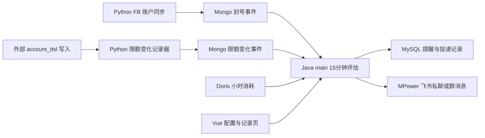

# 预警通知实施文档

> 日期：2026-09-16
>
> 分支：三个仓库均为 `devhs`
>
> 状态：首版代码已完成，待执行数据库迁移、部署和联调

## 1. 实施范围

将原“自动化通知 · 飞书消息”弹窗升级为“媒介资源中心 / 预警通知”菜单页，包含：

1. 封号数量预警；
2. `account_dsl` 限额变化通知；
3. 广告户消耗上限预警；
4. 系统用户私聊和飞书群 Chat ID 收件目标；
5. 每次实际提醒和逐目标投递结果记录；
6. 不发送、不落库的测试预览。

## 2. 服务职责

- Python 只识别并保存事实变化，不判断阈值、不发送通知。
- Java `main` 管理全局配置、轮询 Mongo、查询 Doris、执行规则、幂等、发送飞书和保存记录。
- Java `system` 只新增动态菜单；用户手机号仍取现有 `sys_user`。
- Vue 只负责配置、预览和查询提醒记录。

## 3. 已落地规则

### 3.1 封号数量

- 仅 `account_status` 从非 `2` 变为 `2` 时写事件。
- 首次同步即为 `2` 只建基线，不补历史事件。
- 恢复后再次变为 `2` 会生成新事件。
- 多个 FB 消费者并发同步同一广告户时，使用 Mongo 原子状态切换，只有一个消费者记录事件。
- 阈值统计事件次数，不按广告户去重。
- 窗口支持小时或天，默认 24 小时。
- 持续达到阈值时，北京时间每天最多提醒一次。

Mongo 集合：`fb_ad_account_ban_events`。

### 3.2 限额变化

- 当前 `fb_business_sync` 不从 Meta 拉取 `account_dsl`，且不会清空外部写入的该字段。
- 独立 `account_change_recorder` 默认每 60 秒比较 `fb_ad_accounts.account_dsl` 与状态集合。
- 第一次看到广告户只保存基线；之后记录 `SET`、`INCREASE`、`DECREASE`、`CLEAR`。
- 数值统一转为 `Decimal` 比较，`100`、`100.0`、`100.00` 不会误报。
- 每个变化事件只提醒一次，幂等键为 `LIMIT_CHANGE:{eventId}`。

Mongo 集合：`fb_ad_account_limit_events`、`fb_ad_account_change_state`。

部署入口：`deploy/fb_business_consumer/docker-compose.yml` 中的 `account_change_recorder`。该服务不会随 `fb_asset` 的扩容倍数重复启动。

### 3.3 消耗上限

- 按每个广告户单独判断。
- 窗口支持小时或天，均按滚动时长解释。
- 数据来自 Doris `ad_hourly_detail`，不实时请求 Meta，也不使用 Mongo `amount_spent`。
- 小时表是账户自然日累计快照；Java 使用相邻快照增量计算，遇到自然日归零时从当前值重新累计。
- 触发条件：`窗口消耗 >= 消耗上限 × 提醒比例`。
- 使用 Mongo 广告户资料补充名称和原始币种，不做汇率换算。
- 同一广告户北京时间每天最多提醒一次。

## 4. 数据库

`adpulse-main` 迁移：`V46__create_alert_notification_tables.sql`。

| 表                      | 用途                                       |
| ----------------------- | ------------------------------------------ |
| `ad_alert_config`       | ID 固定为 1 的全局配置                     |
| `ad_alert_recipient`    | USER / CHAT 收件目标                       |
| `ad_alert_poll_cursor`  | Mongo 限额事件持久化消费游标，支持停机续跑 |
| `ad_alert_notification` | 每次实际提醒主记录和触发快照               |
| `ad_alert_delivery`     | 每个收件目标的成功或失败结果               |

表之间使用逻辑关联，不创建数据库外键。提醒表 `dedupe_key` 唯一约束承担并发幂等。

`adpulse-system` 迁移：`V49__add_alert_notification_menu.sql`，在 `/media-resources` 下新增 `/media-resources/alert-notifications`，默认授权 `ADMIN` 角色。

## 5. Java 接口和调度

接口统一挂在 `main` 的 `/alert-notifications`：

| 方法 | 路径        | 用途                                     |
| ---- | ----------- | ---------------------------------------- |
| GET  | `/settings` | 查询全局配置和收件人                     |
| PUT  | `/settings` | 原子保存配置和收件人                     |
| POST | `/preview`  | 使用页面当前草稿生成预览，不发送、不落库 |
| GET  | `/records`  | 按类型、关键字和日期分页查询提醒记录     |

所有接口使用现有 JWT 登录认证。调度器按北京时间每 15 分钟执行一次。

飞书投递：

- USER：读取启用系统用户的手机号，用 MPower 应用换取本应用 `open_id` 后发送私聊；
- CHAT：机器人已入群时，按 Chat ID 发送群消息；
- 测试环境配置固定手机号后，USER 和 CHAT 都改投固定测试用户；
- 凭据只从 `MPOWER_FEISHU_APP_ID`、`MPOWER_FEISHU_APP_SECRET` 或既有 Spring 配置读取；
- 首版不自动重试失败目标，避免没有飞书消息幂等键时重复发送，失败原因会写入投递记录。

## 6. 前端页面

页面：`plat/src/views/media-resources/alert-notifications/index.vue`。

- “通知配置”和“提醒记录”双页签；
- 配置全局开关、系统用户、群 Chat ID、三类规则及各自时间区间；
- 时间窗口使用“数值 + 小时/天”组合控件；
- 窄屏规则字段改单列，记录表仅在表格容器内横向滚动；
- 使用现有浅色语义令牌，所有输入均有可见标签和保存反馈；
- 测试预览明确标注不发送，并使用未保存的当前草稿。

前端 API：`plat/src/api/alert-notifications.ts`。

## 7. 部署顺序

1. 合并三个仓库 `devhs` 代码。
2. 执行 main 的 `V46` 和 system 的 `V49` 迁移。
3. 确认 main 服务具备 Mongo、Doris 和 MPower 飞书环境变量。
4. 重新部署 `fb_business_consumer` compose，使 `account_change_recorder` 建立限额基线。
5. 重启或发布 Java system、main 服务，再发布前端。
6. 先保持总开关关闭，检查 Mongo 变化事件和页面配置读写。
7. 配置测试收件人并开启，验证三种实际提醒及投递记录。
8. 确认测试无误后切换正式收件目标。

## 8. 验收清单

- 已有广告户 `1 -> 2` 只生成一条封号事件；首次即为 `2` 不生成。
- 广告户 `2 -> 1 -> 2` 会生成第二条封号事件。
- `account_dsl` 首轮扫描只建基线；设置、增减、清空各生成一条事件。
- 相同数值不同格式不生成限额事件。
- 封号达到阈值后同一天只提醒一次。
- 单户消耗达到提醒线后同一天只提醒一次，次日仍达到可再次提醒。
- 限额事件重复轮询不会重复创建提醒。
- USER 和 CHAT 分别保存成功或失败投递结果。
- 测试预览不产生 `ad_alert_notification` 和 `ad_alert_delivery` 数据。
- 关闭总开关后不再创建新提醒，历史记录仍可查询。

## 9. 已执行静态验证

- Python：`py_compile`、Ruff、`git diff --check`。
- Java：Spotless、Java 21 Maven compile、`git diff --check`。
- 前端：Prettier、`git diff --check`；仓库全量 `vue-tsc` 仍有大量既有错误，但输出中没有本次 `alert-notifications` 文件错误。
- 按项目约定未执行浏览器交互、黑盒测试或生产部署。
